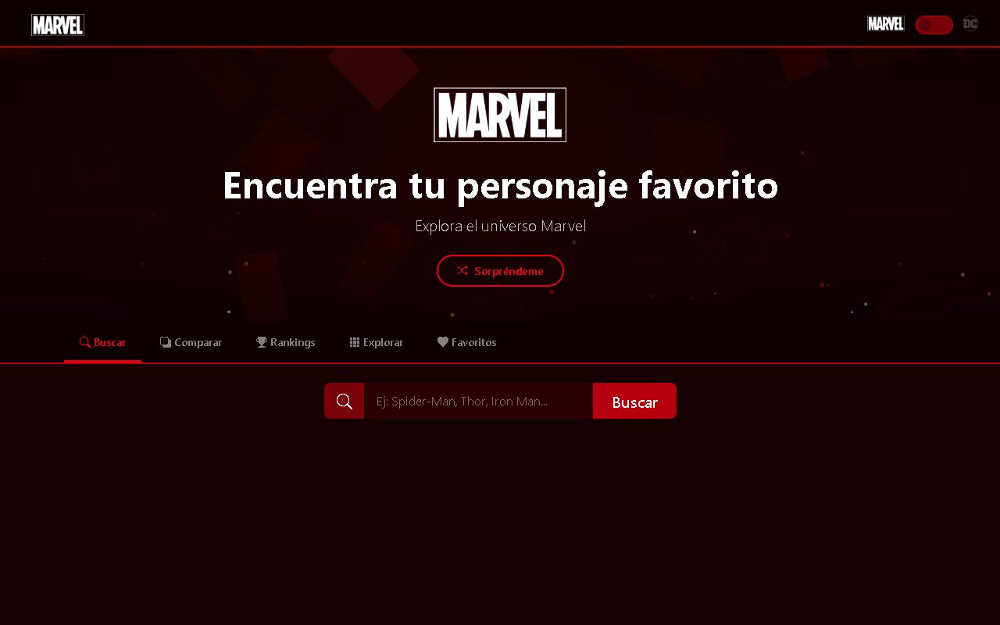
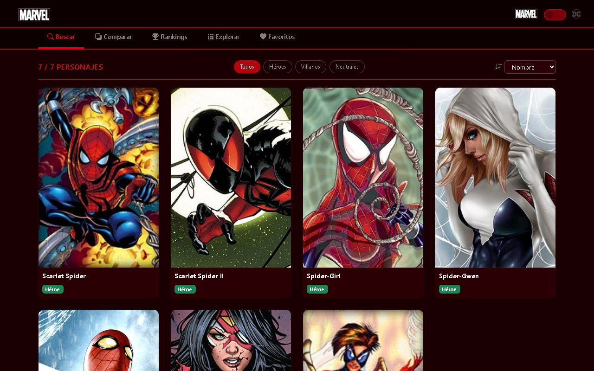
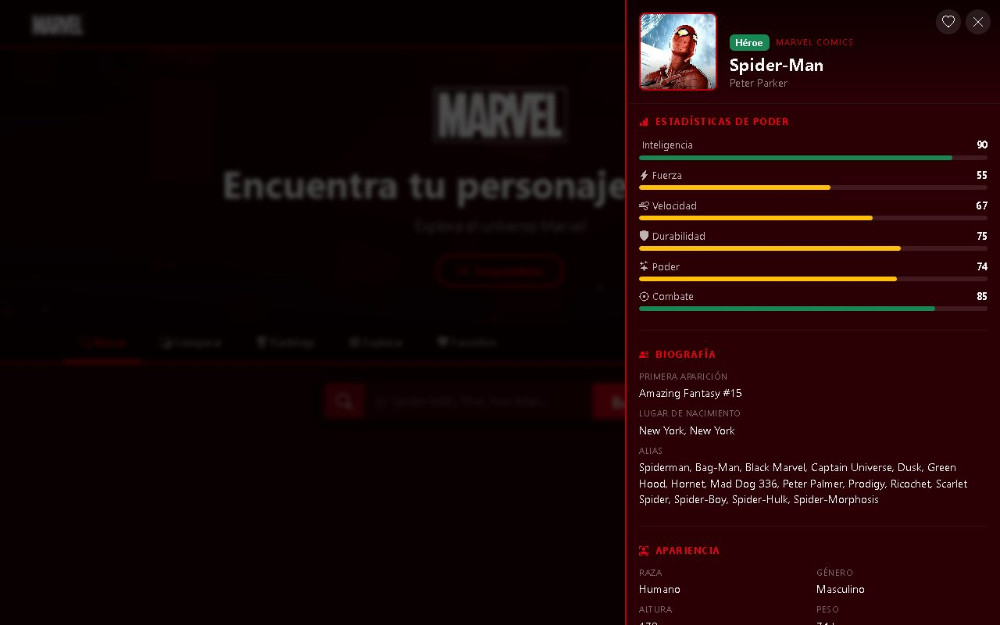
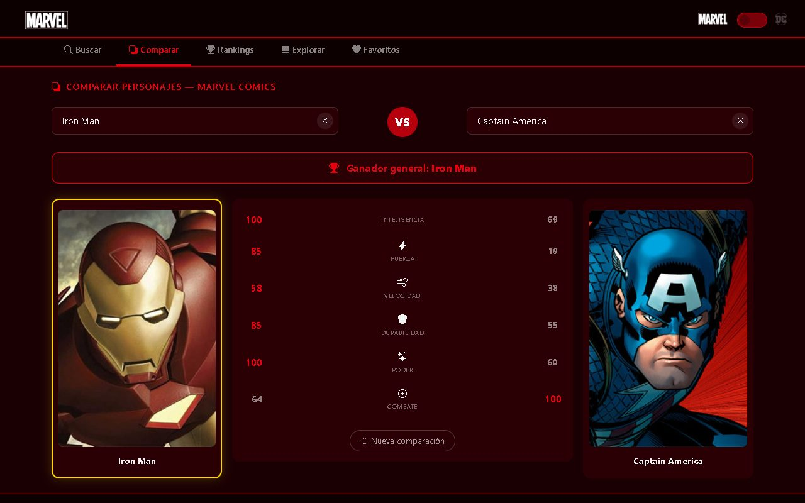
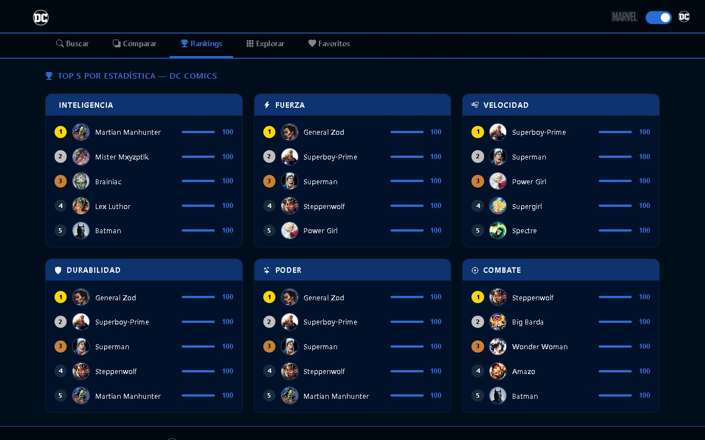
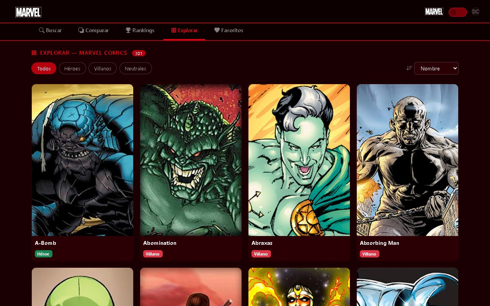
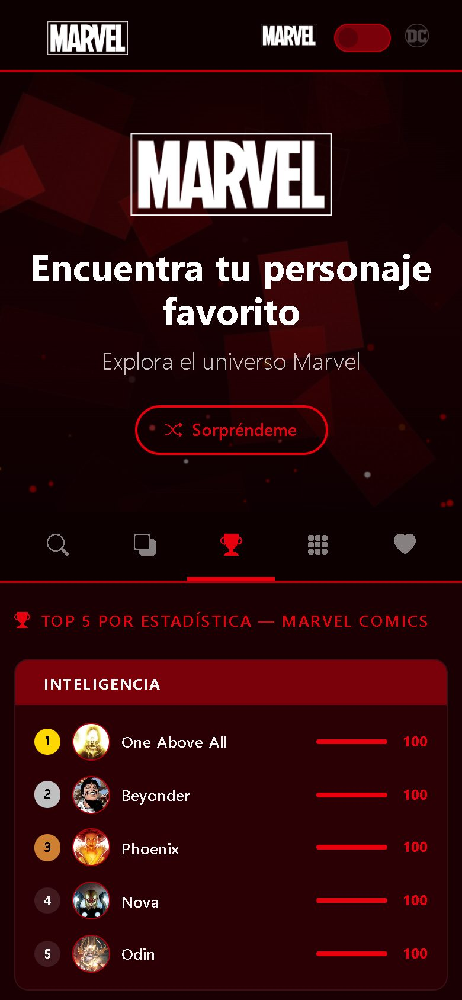

# Buscador de héroes Marvel y DC

Buscador interactivo de más de 400 héroes y villanos de **Marvel** y **DC**, hecho con **Angular 22** (zoneless + Signals). Permite buscar, comparar, rankear y explorar personajes con sus estadísticas de poder, biografía y apariencia, guardar favoritos y cambiar entre ambos universos.

**Demo en vivo:** https://lemon-ground-03c084a0f.3.azurestaticapps.net



## Funcionalidades

| Sección | Qué hace |
|---------|----------|
| **Buscar** | Búsqueda por nombre dentro del universo activo, con resultados en tarjetas y botón "Sorpréndeme" para abrir un personaje al azar. |
| **Detalle** | Panel con las 6 estadísticas de poder, biografía, apariencia, trabajo y conexiones. Se cierra con Escape y devuelve el foco a donde estabas. |
| **Comparar** | Dos personajes frente a frente, estadística por estadística, con ganador por categoría y ganador general. |
| **Rankings** | Top 5 por cada estadística; los empates se desempatan por el poder total. |
| **Explorar** | Catálogo completo con filtro por alineación (héroe, villano, neutral), orden y paginación. |
| **Favoritos** | Lista persistente en el navegador. |

Además:
- **Tema Marvel/DC** que cambia colores, logos y datos de toda la aplicación.
- **Links compartibles:** la URL refleja la sección, el universo y el personaje abierto; el botón "atrás" del navegador funciona como se espera. Por ejemplo, [`?tab=rankings&editorial=dc&heroe=70-batman`](https://lemon-ground-03c084a0f.3.azurestaticapps.net/?tab=rankings&editorial=dc&heroe=70-batman) abre los rankings de DC con Batman.
- **Accesible por teclado:** tarjetas, filas de ranking y comparador se usan con Tab, Enter y Espacio; el detalle atrapa el foco mientras está abierto.
- **Diseño responsive:** en móvil las secciones se muestran como íconos en una sola fila.

## Capturas

| Búsqueda | Detalle |
|---|---|
|  |  |
| **Comparar** | **Rankings (DC)** |
|  |  |
| **Explorar** | **Móvil** |
|  |  |

## Stack

- **Angular 22**: componentes standalone, aplicación *zoneless*, Signals (`signal`, `computed`, `effect`), control flow (`@if`, `@for`) y formularios reactivos.
- **TypeScript 6** y **RxJS** (debounce y `switchMap` en el comparador, caché con `shareReplay`).
- **Bootstrap 5.3** + **Bootstrap Icons**, con variables CSS para el tema de cada universo.
- **Vitest** para los tests unitarios (166 tests).

## Decisiones técnicas

**Modernización de Angular 17 a 22.** El proyecto se actualizó versión por versión con las migraciones oficiales de Angular, se quitó zone.js (la detección de cambios funciona solo con Signals) y los tests pasaron de Karma/Jasmine a Vitest sin perder ninguno. También se eliminaron dependencias sin uso, como el JavaScript de Bootstrap: la carga inicial bajó de 160 KB a 128 KB transferidos.

**Datos propios.** El dataset (SuperHero API, 563 personajes) se incluye en el repo a partir de una versión fija de la fuente, en lugar de descargarse de un servidor externo en cada visita. `npm run data` lo regenera.

**Datos imperfectos de la fuente.** Unos 40 personajes traen el nombre de un alias en el campo "editorial"; el servicio los asigna al universo correcto. Los valores de categoría (género, raza, colores de ojos y cabello) se traducen al español; los textos libres (ocupación, afiliaciones, parientes) se muestran en inglés, tal como los publica la fuente.

**Estado con Signals.** Cada sección deriva su vista con `computed`; la URL se sincroniza con la History API sin necesidad del router.

**Accesibilidad.** Una directiva `appClickable` da rol de botón, foco y activación por teclado a las tarjetas; el detalle usa `role="dialog"`, fondo `inert` y devuelve el foco al cerrar; las secciones usan el patrón de tabs ARIA.

## Cómo ejecutarlo

Requiere Node.js 22.22.3+, 24.15+ o 26+ (mínimo exigido por Angular CLI 22).

```bash
npm install
npm start          # servidor de desarrollo en http://localhost:4200
npm test           # tests unitarios (Vitest)
npm run build      # build de producción en dist/buscador-marvel/browser
npm run data       # regenera src/assets/data/heroes.json desde la fuente
```

## Despliegue

Publicado en **Azure Static Web Apps** (plan Free). Cada push ejecuta el pipeline de Azure DevOps definido en `azure-pipelines.yml`: instala dependencias, corre los tests y hace el build; si el push es a `main` y todo pasa, despliega la nueva versión automáticamente. Los headers de seguridad (CSP incluida) y la caché se configuran en `public/staticwebapp.config.json`.

## Estructura

```
scripts/build-data.mjs          Genera el dataset local
src/assets/data/heroes.json     Dataset de personajes
src/app/
  components/                   Una carpeta por componente (search, character-detail, comparator,
                                top-rankings, explore, favorites, ...)
  directives/                   Directiva de accesibilidad por teclado
  services/                     Datos de personajes y favoritos
  utils/                        Estadísticas, traducciones y sincronización con la URL
public/                         Favicon, 404, robots, sitemap y configuración de Static Web Apps
```

## Fuentes y aviso

- Datos: [SuperHero API](https://github.com/akabab/superhero-api) (licencia MIT); imágenes servidas por jsDelivr.
- Proyecto de portafolio sin fines de lucro, **no oficial y sin afiliación con Marvel ni DC**. Los nombres, personajes y logos pertenecen a sus respectivos dueños.

## Historia

La primera versión (2021) era un buscador en JavaScript sin framework. En 2026 se reescribió en Angular 17 con Signals, y luego se modernizó a Angular 22 con datos propios, accesibilidad completa, links compartibles y despliegue continuo en Azure.
